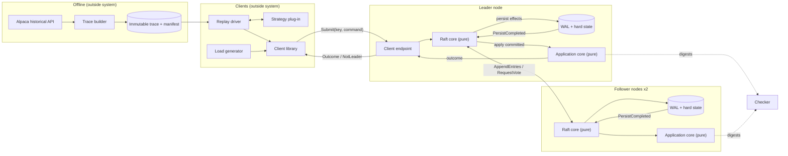

# Architecture

> [!IMPORTANT]
> **Status: proposed design.** No consensus, matching, storage, simulator, or
> transport behavior is implemented yet (see [§11](#11-repository-mapping-and-implementation-status)).
> This document is the canonical home of the project vocabulary
> ([§3](#3-vocabulary)), the system guarantees `G1`–`G5`
> ([§4](#4-guarantees)), and the decision register `D-01`… ([§12](#12-decision-register)).
> The companion documents reference these definitions rather than restating them:
> [raft-design.md](raft-design.md), [execution-model.md](execution-model.md),
> [experiments.md](experiments.md), [limitations.md](limitations.md).

## 1. Research question

The project charter, [start/project.md](start/project.md), is the source of the
research question:

> *Can replicated-log agreement preserve identical committed order, fill, and
> portfolio state after leader failure?*

The charter's setting: a strategy plug-in consumes a bounded trades/quotes
trace and submits simulated orders to a three-node Raft-replicated log; every
replica applies the committed log to the same deterministic matching and
portfolio state machine; leader failure is injected during replay.

Raft alone answers only part of this question. Raft guarantees that nodes agree
on a committed log prefix. Identical *application* state additionally requires
that (a) every state-changing input is in that log, (b) the application
transition is deterministic, and (c) client retries cannot turn one logical
request into two effects. The architecture is organized around those three
additional conditions. The working hypothesis and sub-questions `RQ1`–`RQ6` are
stated in [experiments.md §1](experiments.md#1-research-questions-and-hypotheses).

## 2. Sources and how they were reconciled

| Source | Role in this design | Notes |
|---|---|---|
| [start/project.md](start/project.md) | Research question and system concept | Authoritative for *what is asked*. Says "trades/quotes trace" and "matching". |
| [start/rust-tech-scope.md](start/rust-tech-scope.md) | Scope, invariants, failure matrix, baselines | Same core design as the C++ scope; differs only in toolchain/adapters. |
| [start/rust-quant-tech-stack-research.md](start/rust-quant-tech-stack-research.md) | Stack rationale, architecture sketch, scenario list | Header reads "Decision: Rust". |
| `docs/start/cplusplus-tech-scope.md`, `docs/start/cplusplus-quant-tech-stack-research.md` | Same, for C++23 | **Deleted from the working tree** in commit `2b99368`; readable with `git show 2b99368^:docs/start/cplusplus-tech-scope.md`. Header reads "Decision: C++23". |
| `docs/README.md` | Research context, glossary, `Q1`–`Q6` | **Deleted** in commit `1b093e0` (C++ wording). A Rust-worded copy lives at [../README.md](../README.md). |
| [scoping/mvp.md](scoping/mvp.md) | Delivery-oriented MVP | Proposes OHLCV bars, market orders, next-bar-open fills, no order book. Conflicts with charter/scope (`D-02`). |
| [scoping/structure.md](scoping/structure.md) | Repository layout and starter interfaces | Single crate; matches the current skeleton. Conflicts with the workspace proposal (`D-04`). |
| [scoping/ideas/](<scoping/ideas/Building Raft From Scratch for the Alpaca Trading Sandbox.md>), [api_combinations.md](scoping/ideas/api_combinations.md) | Exploratory notes | Timer defaults, orders-only vs full-event replication, data options. |
| [alpaca_apis/](alpaca_apis/historical_bars_api.md) + `sample_data/` | Market-data formats | Prices appear with up to four decimals (e.g., `470.9605`), which drives `D-08`. |
| [research/](research/) | Normative and background literature | Ongaro & Ousterhout (Raft), Ongaro dissertation, Schneider (RSM), Gjengset, Howard & Mortier, TiDB. |

Reconciliation rules used throughout:

1. The charter decides the question being answered. Where a delivery proposal
   would no longer answer it, the conflict goes into the decision register.
2. Where the Rust and C++ documents agree (they do on every protocol,
   application, durability, and evaluation point), the design uses the shared
   content with neutral wording.
3. Where they differ only in toolchain or adapter, the decision register
   ([§12](#12-decision-register), `D-01`, `D-04`, `D-05`) records the difference;
   the core design does not depend on it.
4. Recency or level of detail is not treated as acceptance.

## 3. Vocabulary

These terms have exactly one meaning across all five documents.

### 3.1 Entry lifecycle states

An entry may be in several of these states at once. They are listed in the
order in which they can first become true for a client command. None of them
implies a later one.

| State | Precise meaning | Established by |
|---|---|---|
| **Written** | The node has issued a write of the entry's bytes to its WAL file; the bytes may still be in a process or OS buffer. | Write call returned. |
| **Synchronized** | The entry's WAL record (and any preceding records/truncations) is durable on that node's storage according to the platform durability primitive ([raft-design.md §9.3](raft-design.md#93-durability-primitive)). | Sync completion reported by the storage adapter to the core. |
| **Replicated** (on node *n*) | The leader has received a successful `AppendEntriesResponse` from *n* covering the entry. Because a follower responds only after synchronizing ([raft-design.md §9](raft-design.md#9-persistence-before-response-and-effect-ordering)), replicated implies synchronized on *n*. | Leader updates `match_index[n]`. |
| **Committed** | The entry is at or below an index `N` for which the leader has observed a majority (2 of 3, counting itself only once synchronized) with `match_index ≥ N` and `log[N].term == current_term`; or it precedes such an entry. A node *knows* an entry is committed when its local `commit_index` covers it. | Raft commitment rule ([raft-design.md §8.6](raft-design.md#86-commitment)). |
| **Applied** (on node *n*) | Node *n*'s application state machine has executed the entry; `last_applied ≥ index`. Applied state is volatile and is rebuilt after restart. | `apply` returned on *n*. |
| **Acknowledged** | The leader has sent the client a definitive outcome for the request contained in the entry. Sending does not imply the client received it. | Response effect executed. |

"Durably committed" is redundant in the durable configuration: committed already
requires synchronized copies on a majority. In the memory-only baseline `B3`
([experiments.md §4](experiments.md#4-baselines)), "committed" has **no**
durability meaning, and `G3` does not hold.

### 3.2 Other terms

- **Node** — one of the three fixed cluster members (`n1`, `n2`, `n3`). "Replica"
  is used only when stressing the application copy.
- **Command** — any input that may change replicated application state
  (`Genesis`, `MarketEvent`, `SubmitOrder`; `CancelOrder` deferred). Defined in
  [execution-model.md §2](execution-model.md#2-commands-and-the-request-envelope).
- **Log entry** — `(index, term, kind, payload)`, where `kind ∈ {Noop, Command}`.
- **Request** — a command plus its **idempotency key** `(client_id, request_sequence)`.
- **Outcome** — the deterministic result of applying a request (`Accepted …` or
  `Rejected(reason)`), cached in the replicated session table.
- **Effect** — an action requested by a pure core and executed by an adapter:
  persist, send, apply, respond, set timer.
- **Common applied index** — an index `i` such that two or more nodes (or two
  incarnations of one node) have each applied through `i`. State is compared only
  at common applied indexes ([experiments.md §7.2](experiments.md#72-comparison-at-common-applied-indexes)).
- **Component digest** — SHA-256 over the canonical encoding of one state
  component ([execution-model.md §9](execution-model.md#9-canonical-state-encoding-and-digests)).
- **Effectively-once logical execution** — each logical request (idempotency
  key) produces at most one application effect, and a client that retries until
  it receives an outcome gets the outcome of that single effect. Transport is
  at-least-once; this is **not** exactly-once message delivery.
- **Incarnation** — one process lifetime of a node between start and crash/stop.

## 4. Guarantees

These guarantees are the claims under test. Each holds only under the failure
model in [limitations.md §1](limitations.md#1-failure-model-assumptions).

| ID | Guarantee | Mechanism | Specified in |
|---|---|---|---|
| **G1** Log agreement | No two nodes apply different entries at the same index (Raft State Machine Safety). | Restricted Raft. | [raft-design.md §11](raft-design.md#11-safety-invariants) |
| **G2** Deterministic application | Any two applications of the same committed prefix through index `i`, on any node or incarnation, yield identical component digests at `i`. | Pure `apply`, integer arithmetic, canonical ordering, all inputs in the log. | [execution-model.md §5–§9](execution-model.md#5-deterministic-matching) |
| **G3** Durability of acknowledged requests | If a request was acknowledged, its effect is in the committed prefix of every later leader, as long as no node loses synchronized data. | Persistence-before-response; majority commitment; Leader Completeness. | [raft-design.md §9](raft-design.md#9-persistence-before-response-and-effect-ordering) |
| **G4** Effectively-once logical execution | Each idempotency key affects application state at most once. Every retry after the first application returns the cached original outcome. | Replicated session table checked inside `apply`. | [execution-model.md §4](execution-model.md#4-replicated-request-deduplication) |
| **G5** Conditional liveness | If a majority of nodes are up, can communicate with message delay well below the election timeout, and have working storage for long enough, a leader is elected and new requests are committed and acknowledged. | Randomized timeouts, heartbeats, leader no-op. | [raft-design.md §12](raft-design.md#12-liveness-assumptions) |

`G1`–`G4` are safety properties: they must never be violated under any modeled
fault. `G5` is conditional, and a violation outside its assumptions is a
reportable observation, not a safety failure.

## 5. System boundary

**Inside the system (replicated, deterministic):** the Raft log, the matching
engine, the order book, orders, fills, accounts, the market reference state, and
the client session (deduplication) table.

**Inside the system (per node, not replicated):** Raft volatile state, WAL files,
timers, connections, metrics, the inspection endpoint.

**Outside the system:**

- market-data acquisition (Alpaca HTTP) and normalization into an immutable trace;
- the strategy plug-in and replay driver (both clients);
- the experiment harness, checker, load generator, and plotting;
- operators (start, kill, restart, partition).

Everything outside the system interacts only through the client API or the
inspection API, or by controlling processes and the network. No component
outside the log may change replicated state. In particular, replicas never read
market data directly. Market data affects state only as committed
`MarketEvent` commands ([execution-model.md §2](execution-model.md#2-commands-and-the-request-envelope)).

## 6. Three-node deployment

| Property | MVP value | Source |
|---|---|---|
| Membership | Fixed `{n1, n2, n3}` from static configuration; never changes at runtime. | scope docs; [scoping/mvp.md](scoping/mvp.md) |
| Quorum | Any 2 of 3. | Raft |
| Topology | Three OS processes on one Linux host for the MVP; optional three hosts for later measurements. | [scoping/mvp.md](scoping/mvp.md) §2 |
| Peer/client ports | Proposed `7001`–`7003` (one listener per node, or separate peer/client ports; see `D-05`). | ideas doc §2 |
| Durable state | `runtime/node-N/` per node: hard-state file and WAL segments. | [scoping/structure.md](scoping/structure.md) |
| Configuration | `config/cluster.toml` (node IDs, addresses, timer ranges, storage mode). Currently empty. | repository |

Fault tolerance: the cluster tolerates one crashed or partitioned node. With two
nodes down, it must stop committing (`F14`) but never diverge. A single host is
one shared failure domain for power, kernel, disk, and clock. This limits the
evidence ([limitations.md §4.4](limitations.md#44-performance-generalizability)).

## 7. Components and responsibilities

| Component | Responsibility | Pure? | Interfaces |
|---|---|---|---|
| **Trace builder** | Convert Alpaca JSON (bars/quotes/trades) into a normalized, immutable JSON Lines trace with integer ticks and a manifest (hash, source, feed, date range). | n/a (offline) | file in, file out |
| **Replay driver** | Read the trace and submit `Genesis` and `MarketEvent` requests in trace order. In lockstep mode, invoke the strategy between events ([execution-model.md §11](execution-model.md#11-replay-driver-and-strategy)). | no | Client library |
| **Strategy plug-in** | Decide orders from market events it has been shown. It never sees future events. | yes (deterministic given inputs) | `on_event(event) -> [OrderIntent]` |
| **Client library** | Assign idempotency keys, discover the leader, retry with the same key, surface outcomes. | no | Client API |
| **Raft core** | Elections, replication, conflict repair, commitment, and selection of entries ready to apply. It returns effects and never performs I/O. | **yes** | `step` ([§8.1](#81-raft-core)) |
| **Application core** | Validation, deduplication, matching, portfolio accounting, canonical digests. | **yes** | `apply`, `digest` ([§8.2](#82-application-core)) |
| **Node driver** | Owns one Raft core and one application core. It feeds inputs and executes effects in the required order ([raft-design.md §9.2](raft-design.md#92-effect-ordering-contract)). One logical owner mutates core state. | no | ports ([§8.3](#83-ports-implemented-by-adapters)) |
| **Production adapters** | TCP transport, file WAL, monotonic clock, process lifecycle. | no | ports |
| **Simulation adapters** | Virtual clock, simulated network (delay/drop/duplicate/reorder/partition), simulated storage (sync loss, torn tails, errors), and crash/restart. Every choice is driven by one seeded PRNG. | no (deterministic) | ports |
| **Inspection endpoint** | Report role, term, leader, log tail, `commit_index`, `last_applied`, replication progress, and digests at `last_applied`. | no | Inspection API |
| **Checker / harness** | Inject faults, collect per-node applied-digest logs, compare at common applied indexes, verify `G3`/`G4` from client logs, emit verdicts. | no | files, Inspection API |
| **Load generator** | Open-loop request schedule for performance runs. | no | Client library |

## 8. Interfaces

The notation is language-neutral. `bytes` is an opaque byte string, `[T]` is an
ordered sequence, `T?` is optional. Concrete type names follow the selected
language adapter (`D-01`).

### 8.1 Raft core

```text
RaftCore.new(config: ClusterConfig, me: NodeId, hard: HardState,
             log: [LogEntry], rng_seed: u64) -> RaftCore
RaftCore.step(input: RaftInput) -> Ready

RaftInput  = Tick                                   -- one logical clock tick
           | Receive(from: NodeId, msg: RaftMessage)
           | Propose(request_bytes: bytes, reply_to: ResponseToken)
           | PersistCompleted(token: PersistToken)  -- storage durability callback
           | Applied(index: LogIndex)               -- application progress

Ready      = { persist:  PersistBatch?,  -- hard state / truncation / appends, with token
               send:     [Outbound],     -- each tagged with the PersistToken it depends on
               apply:    [LogEntry],     -- committed, not yet applied, in index order
               respond:  [ClientReply],  -- e.g. NotLeader for proposals on a follower
               timers:   TimerUpdate? }
```

The full input/effect contract and its ordering rules are in
[raft-design.md §7](raft-design.md#7-core-interface) and
[§9](raft-design.md#9-persistence-before-response-and-effect-ordering).

### 8.2 Application core

```text
AppState.genesis_empty() -> AppState
apply(state: AppState, index: LogIndex, term: Term, entry: EntryKind,
      payload: bytes) -> (AppState, ApplyResult)
ApplyResult = { key: IdempotencyKey?, outcome: Outcome?, events: [DomainEvent] }
digest(state: AppState) -> ComponentDigests
```

`apply` is total. Malformed or invalid input yields a deterministic `Rejected`
outcome. It never yields a panic or exception, never reads time, randomness,
node identity, or environment, and never performs I/O
([execution-model.md §5](execution-model.md#5-deterministic-matching)).

### 8.3 Ports implemented by adapters

| Port | Operations | Production adapter | Simulation adapter |
|---|---|---|---|
| `Storage` | `load() -> (HardState, [LogEntry])`; `persist(batch, token)` → later `PersistCompleted(token)` | WAL + hard-state file, `fsync`/`fdatasync` | in-memory "disk" with separate *written* and *synchronized* images; crash discards unsynchronized bytes or leaves a torn tail per seed |
| `Transport` | `send(to, msg)`; inbound → `Receive` | TCP, length-prefixed frames | event queue with seeded delay/drop/duplicate/reorder/partition |
| `Clock` | periodic `Tick`; monotonic time for metrics only | OS monotonic timer | virtual time advanced by the event loop |
| `Lifecycle` | start, crash, restart | real processes, `SIGKILL`, failpoints | drop all volatile state; reload from the synchronized image |
| `ClientEndpoint` | inbound requests → `Propose`; `ClientReply` out | TCP/RPC server | simulated clients in the same event loop |

### 8.4 Client API

```text
Submit(client_id: u64, request_sequence: u64, command: Command) ->
    Outcome(key, outcome, duplicate: bool)    -- definitive
  | NotLeader(leader_hint: NodeId?)           -- not definitive; retry
  | Retryable(reason)                         -- leadership lost while pending; retry
```

A timeout or a lost connection is **not definitive**. The client must retry the
same key and payload ([execution-model.md §10](execution-model.md#10-client-responses-and-retry)).

### 8.5 Inspection API (evidence only)

`Status() -> {node, incarnation, role, term, leader_hint, last_log_index,
last_log_term, commit_index, last_applied, match_index[], digests@last_applied}`.
Inspection reads are **not linearizable** and must never be used as client
reads. Linearizable reads are deferred ([raft-design.md §13](raft-design.md#13-mvp-versus-deferred-features)).

## 9. Command and data flow



Normal path for one request. Lifecycle states are from [§3.1](#31-entry-lifecycle-states).

1. The client library sends `Submit(key, command)` to the presumed leader.
2. The leader's client endpoint performs stateless admission checks
   ([execution-model.md §3](execution-model.md#3-validation)) and passes
   `Propose` to the Raft core.
3. The core appends the entry in memory and emits a `PersistBatch`. The entry is
   **written** and then **synchronized**. The core learns the second fact only
   via `PersistCompleted`.
4. The leader sends `AppendEntries`. Each follower synchronizes the entry
   *before* replying success. The entry is now **replicated** on that follower.
5. With one follower's success plus its own synchronized copy, the leader marks
   the entry **committed** (current-term rule).
6. The core emits the entry in `Ready.apply`. The application core **applies**
   it and produces an outcome (or the cached outcome for a duplicate key).
7. The leader sends the outcome (**acknowledged**). Followers apply the entry
   when they learn the new `commit_index` and never respond to clients.

The detailed trace, including validation and the lost-response case, is in
[execution-model.md §1](execution-model.md#1-request-lifecycle).

## 10. Production and simulation execute the same cores

Both environments link the **same** Raft core and application core. They differ
only in the adapters behind the ports in [§8.3](#83-ports-implemented-by-adapters).

```text
loop:
    input  := environment.next_input()          -- network, timer, storage callback, client
    ready  := raft.step(input)
    driver.execute(ready)                       -- ordering per raft-design §9.2
    for entry in ready.apply:                   -- strictly in index order
        (app, result) := apply(app, entry...)
        raft.step(Applied(entry.index)); maybe respond(result)
```

| Requirement | Why |
|---|---|
| Cores contain no I/O, async runtime, clock reads, threads, or global state. | Lets the simulator substitute every source of nondeterminism. |
| The Raft core receives randomness only from its injected seeded PRNG. | Seeded replay of elections. |
| The simulator orders same-time events by a stable tie-breaker (`time`, `sequence`). | Identical event histories for identical seeds. |
| Simulated storage models *written* vs *synchronized* separately. | Crash windows between write and sync are reproducible. |
| Every simulated run prints `(revision, config hash, seed)` and writes its event history. | Failures are replayable ([experiments.md §7.1](experiments.md#71-seed-replay)). |
| Production adapters log the PRNG seed and every injected fault. | Real-process runs are auditable, though not bit-replayable. |

The simulator tests core logic and the driver's effect ordering under modeled
faults. Production adapters are tested by real-process scenarios. Neither
substitutes for the other ([limitations.md §3](limitations.md#3-what-the-evidence-does-and-does-not-establish)).

## 11. Repository mapping and implementation status

**Status as reviewed (HEAD `791de25` plus uncommitted edits in progress):**

- Every file under `src/raft/`, `src/execution/`, `src/market/`,
  `src/strategy/`, `src/common/`, `tests/`, `config/`, and `scripts/` is
  **empty**. No protocol, matching, storage, simulator, or experiment code exists.
- `Cargo.toml` (edition 2024) depends only on `clap`. The uncommitted
  `src/main.rs`, `src/lib.rs`, and new `src/handler/` are being edited
  concurrently. They reference benchmark-spec concepts (`spec.yaml`,
  `benchmarks/`, `adapters/`, `compiler`) that are unrelated to this project, and
  the crate did not compile at review time. These documents do not depend on
  that code.
- No `experiments/`, `results/`, `data/`, `spec/tla/`, simulator, or benchmark
  artifacts exist. **No experiment has been run.**

Proposed mapping of components onto the existing skeleton (single crate, per
`D-04`):

| Component | Existing path | Observation |
|---|---|---|
| Raft core | `src/raft/{node,election,replication,log,rpc}.rs` | Suitable. Keep free of Tokio/file/clock imports. |
| Raft adapters | `src/raft/{transport,storage,timer}.rs` | These are effectful adapters inside the core's module. Recommend a separate `runtime`/`adapters` module so the purity boundary is visible. |
| Application core | `src/execution/{command,validation}.rs` | Missing `order`, `book`, `portfolio`, `session`, `digest`, `state_machine` files that [scoping/structure.md](scoping/structure.md) proposes. |
| Harness concerns | `src/execution/{faults,metrics}.rs` | [scoping/structure.md](scoping/structure.md) places these in `experiments/`. Inside `execution/` they blur the "no I/O in apply" rule. Recommend moving. |
| Trace builder / replay | `src/market/{alpaca,bar,replay}.rs`, `scripts/fetch_spy.sh` | Bars only; quotes/trades adapters absent (`D-02`). |
| Strategy | `src/strategy/sma_crossover.rs` | 5/20 SMA per [scoping/mvp.md](scoping/mvp.md). |
| Simulator | none | A primary deliverable per the scope docs; needs a module. |
| Tests | `tests/raft_{election,replication,recovery}.rs`, `tests/execution_determinism.rs`, `tests/end_to_end.rs` | Empty; mapped to experiments in [experiments.md §9](experiments.md#9-mvp-tests-versus-tests-requiring-deferred-features). |

## 12. Decision register

Status values: **Unresolved** (needs an owner decision), **Proposed** (this
design adopts it pending objection), **Accepted** (explicitly agreed in the
repository). No decision is currently *Accepted*.

| ID | Decision | Conflict / gap | Consequence if left open | Recommended resolution | Status |
|---|---|---|---|---|---|
| **D-01** | Implementation language | Rust research says "Decision: Rust"; deleted C++ research says "Decision: C++23". No ADR ratifies either. The skeleton, [scoping/mvp.md](scoping/mvp.md), and [../README.md](../README.md) assume Rust. | Toolchain-specific evidence (sanitizers vs. Loom/Miri, CI) and adapter libraries cannot be fixed. Core design is unaffected. | Write a one-page ADR. The existing Cargo skeleton and Rust-based MVP plan lower switching cost for Rust. If C++ is chosen instead, remove the Cargo scaffold and restore the C++ documents. | **Unresolved** |
| **D-02** | Execution model and market data | Charter: trades/quotes trace + matching. Scope: CLOB, limit orders, price-time priority. [scoping/mvp.md](scoping/mvp.md): OHLCV bars, market orders, next-bar-open fills, no partial fills, "not a full order-matching engine". | Without a CLOB, the charter's "matching" claim and price-time determinism (`RQ2`) go untested. Without a bars path, the simplest MVP data source is unusable. | Adopt a minimal one-instrument CLOB. Committed `Quote` events become external-counterparty liquidity. Bars are converted to quotes **upstream** of the log, which keeps the MVP's bar data and next-bar semantics ([execution-model.md §5.3](execution-model.md#53-external-liquidity-from-market-events)). | **Proposed** |
| **D-03** | What enters the log | Scope: every state-changing input enters the log. [api_combinations.md](scoping/ideas/api_combinations.md) proposes an "orders-only" baseline. | Orders-only leaves market state outside consensus, so `G2` cannot be claimed. | Full-event replication for all correctness experiments. Orders-only is at most a labeled performance comparison and is not part of the MVP. | **Proposed** |
| **D-04** | Code organization | Scope/research: multi-crate workspace (or CMake targets). [scoping/structure.md](scoping/structure.md) and the skeleton: single crate. | Purity is enforced by review rather than by the dependency graph. | Keep the single crate for the MVP. Enforce "cores import no runtime/file/clock" with a lint or CI grep. Split into crates when the simulator lands. | **Proposed** |
| **D-05** | Wire format and transport | Scope: Tonic + Prost (Rust) or Protobuf over framed TCP (C++). Ideas doc: serde JSON/bincode. Structure doc: serde derives. | Affects only adapters. The log payload is canonical bytes regardless ([execution-model.md §9](execution-model.md#9-canonical-state-encoding-and-digests)). | Carry log payloads as opaque canonical bytes inside any envelope. Pick the transport with the least adapter code. Never hash or persist transport-encoded bytes as state. | **Unresolved** |
| **D-06** | Persistence technology and layout | Scope: project-owned WAL. Ideas doc: "SQLite or file-based WAL". Layout of hard state vs. entries is unspecified. | SQLite would hide the durability semantics the project studies. | Project-owned WAL for entries and truncation. Separate hard-state file replaced atomically ([raft-design.md §10](raft-design.md#10-storage-format-and-crash-recovery)). | **Proposed** |
| **D-07** | Digest and checksum algorithms | Scope: CRC32C for WAL records. [scoping/mvp.md](scoping/mvp.md) and structure: SHA-256 state hash. | None if roles stay distinct. | CRC32C per WAL record (corruption detection). SHA-256 over canonical encodings (state comparison). | **Proposed** |
| **D-08** | Price and cash units | Scope: "integer ticks and lots", unit unspecified. Alpaca samples have 4-decimal prices. [scoping/mvp.md](scoping/mvp.md) uses `cash_cents`. | Cents cannot represent `470.9605` exactly, forcing rounding inside the trace builder. | 1 price tick = 1 cash unit = 0.0001 USD. 1 lot = 1 share. Recorded in `Genesis`. Reject trace values not exactly representable. | **Proposed** |
| **D-09** | Client identity and sessions | Not specified. Ongaro's dissertation (§6.3) uses explicit client registration and session expiry. | Unbounded or ambiguous session tables; a crashed client may reuse keys. | MVP: client IDs are pre-assigned in `Genesis`; one outstanding request per client; no expiry. Registration and expiry are deferred. | **Proposed** |
| **D-10** | Per-client pipelining | One-outstanding-request clients (`D-09`) conflict with open-loop load. | Open-loop generators need many client IDs or queue at the client. | Use a pool of client IDs sized for the target rate, and measure latency from the *intended* send time ([experiments.md §7.3](experiments.md#73-open-loop-load-generation)). Windowed sessions are deferred. | **Proposed** |
| **D-11** | Order types | Scope: limit orders; cancellation after stable submission. [scoping/mvp.md](scoping/mvp.md): market orders. | Market orders without a book are the bar-fill model in `D-02`. | MVP: GTC limit orders only. A marketable limit emulates a market order. IOC and `CancelOrder` are deferred. | **Proposed** |
| **D-12** | Initial state | [scoping/mvp.md](scoping/mvp.md): $100,000 cash, implicit. | If each node reads initial balances from local config, misconfiguration diverges state outside the log. | Initial state is set only by a committed `Genesis` command. The $100,000 default lives in the replay driver's config. | **Proposed** |
| **D-13** | Leader no-op entry | Not in any project document. Standard in Ongaro's dissertation §6.4. | Without it, a new leader cannot commit earlier-term entries (or resolve pending retries) until new client traffic arrives. After a full-cluster restart, `commit_index` stays 0 until then. | Leader appends a `Noop` entry on election (MVP). | **Proposed** |
| **D-14** | Fault matrix contents | Scope list includes "stale-term messages"; research list includes "repeated elections then stability" instead. Both list snapshot installation. | Two subtly different acceptance sets. | Use the union ([experiments.md §5](experiments.md#5-fault-matrix)). Snapshot scenario is deferred. | **Proposed** |
| **D-15** | Durability primitive on development hosts | Not addressed. On macOS, `fsync` does not force the drive cache; `F_FULLFSYNC` does. | Crash-durability claims made from macOS runs would be unsupported. | Linux is the reference platform for durability and performance evidence. The macOS adapter uses `F_FULLFSYNC`, or its runs are labeled non-durable. | **Proposed** |
| **D-16** | CLI surface | [scoping/structure.md](scoping/structure.md): `node`, `fetch`, `replay`, `validate`. Current uncommitted CLI: `list`, `fetch`, `validate <spec.yaml>`, `compile`, `verify-compiler`. | Scripts and experiment docs cannot reference stable commands. | Adopt the structure-doc command set plus `simulate` and `check`. Treat the current handler as unrelated work in progress. | **Unresolved** |

## 13. Stale references and repository hygiene

Found during review. Recorded here and not fixed, because fixing them would modify
files outside this task.

- [../README.md](../README.md) links `docs/project.md`,
  `docs/quant-tech-stack-research.md`, and `docs/technology-scope.md`, which do
  not exist. The current paths are [start/project.md](start/project.md),
  [start/rust-quant-tech-stack-research.md](start/rust-quant-tech-stack-research.md),
  and [start/rust-tech-scope.md](start/rust-tech-scope.md).
- The C++ scope/research documents and `docs/README.md` exist only in git
  history ([§2](#2-sources-and-how-they-were-reconciled)).
- [research/markdown/](research/markdown/) contains
  `Scoping Document_ Runtime Execution & Classical Co-Processor Layer.md`, which
  describes an unrelated quantum-benchmarking project ("sqbm").
- The Raft paper (`In Search of an Understandable Consensus Algorithm.pdf`) has
  no markdown conversion, unlike the other papers.
- [scoping/structure.md](scoping/structure.md) proposes `src/execution/{order,fill,portfolio,state_machine}.rs`
  and `src/experiments/`. The skeleton instead has
  `src/execution/{faults,metrics,validation}.rs` and no `experiments/` module.
- Commit `97105d8` is titled "adding .env with alpaca api secrets", but it only
  changed `.gitignore`; `.env` does not appear anywhere in history. It is a local,
  gitignored file. The trace builder should read credentials from the
  environment and must never copy them into traces, manifests, or artifacts.
