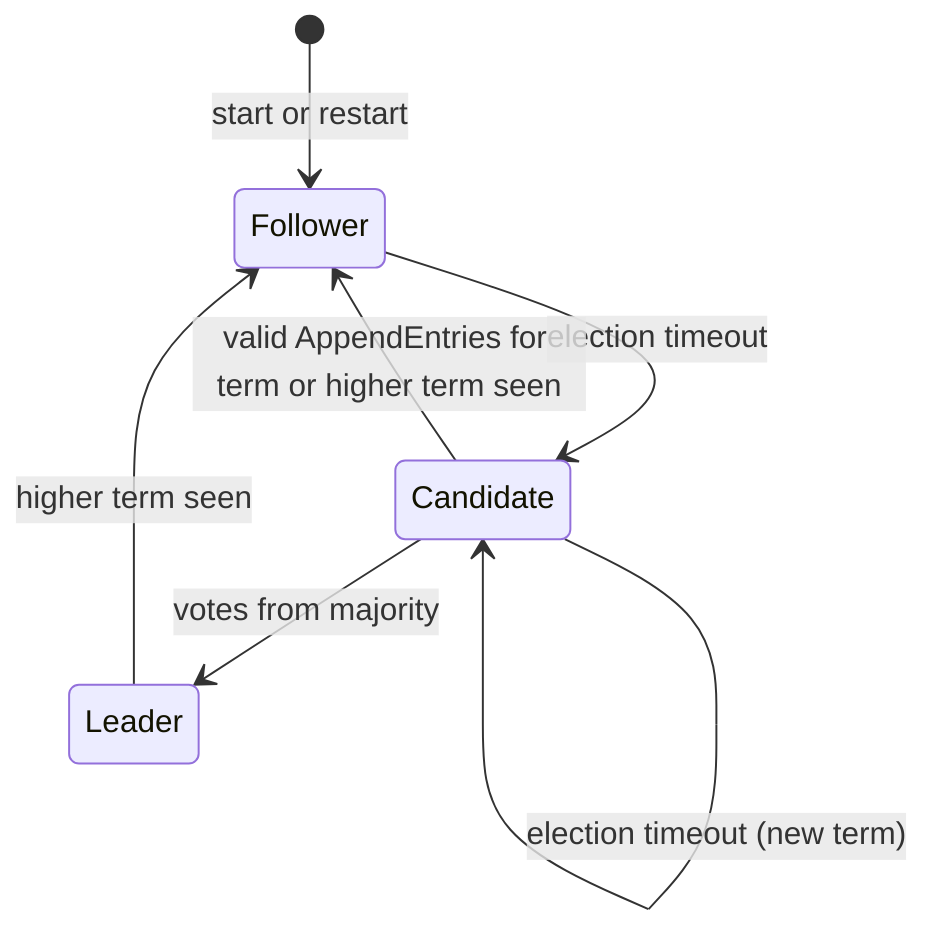

# Restricted Raft Design

> [!IMPORTANT]
> **Status: proposed design. Not implemented.** This specifies the consensus
> core that [architecture.md](architecture.md) places behind the `RaftCore`
> interface. It follows Figure 2 and §5 of Ongaro & Ousterhout,
> [*In Search of an Understandable Consensus Algorithm*](<research/In Search of an Understandable Consensus Algorithm.pdf>),
> and the client and persistence guidance in Ongaro's
> [dissertation](<research/CONSENSUS: BRIDGING THEORY AND PRACTICE.pdf>) (Ch. 3, 6, 10),
> restricted as listed in [§13](#13-mvp-versus-deferred-features). Lifecycle
> terms (*written*, *synchronized*, *replicated*, *committed*, *applied*,
> *acknowledged*) and guarantees `G1`–`G5` are defined in
> [architecture.md §3–§4](architecture.md#3-vocabulary).

## 1. Scope

The core implements leader election, heartbeats, log replication, conflict
repair, majority commitment, ordered delivery of committed entries to the
application, and crash/restart recovery for a fixed three-node cluster. It is a
pure state machine: it never performs I/O, reads clocks, or spawns work. The
node driver executes its effects in the order fixed by
[§9](#9-persistence-before-response-and-effect-ordering).

## 2. Constants and conventions

| Item | Value |
|---|---|
| Members | `n1`, `n2`, `n3`, fixed at startup (`config/cluster.toml`). |
| Majority | 2. |
| Log indexes | 1-based. No physical sentinel entry. An empty log has `last_log_index = 0`, `last_log_term = 0`. `prev_log_index = 0` always matches. |
| Terms | `u64`, starting at 0. A node's first election uses term 1. |
| Time | The core counts logical `Tick` inputs. The adapter sets the tick period. |
| Election timeout | Drawn uniformly from `[E_min, E_max]` with the core's seeded PRNG at every reset. Proposed defaults `300–600 ms`. |
| Heartbeat interval | `H`, proposed `75 ms`, with `H ≪ E_min`. |
| Batch bound | At most `max_entries_per_append` entries per `AppendEntries` (proposed 64). |

Timer defaults come from the ideas note
([§3.B](<scoping/ideas/Building Raft From Scratch for the Alpaca Trading Sandbox.md>)),
which treats them as test parameters. They affect liveness only
([§12](#12-liveness-assumptions)).

## 3. Roles



Every node starts as follower, including after a crash. Role is volatile.

## 4. State

### 4.1 Persistent (synchronized before it is relied on externally)

| Field | Meaning |
|---|---|
| `current_term` | Highest term observed. Never decreases, including across restarts. |
| `voted_for` | Candidate voted for in `current_term`, or none. |
| `log[1..]` | Entries `(index, term, kind, payload)`. |

### 4.2 Volatile, all nodes

| Field | Meaning | After restart |
|---|---|---|
| `role`, `leader_hint` | Current role; last known leader. | Follower; none. |
| `commit_index` | Highest index known committed. | 0. Relearned from the leader ([§10.5](#105-what-a-restart-does-and-does-not-restore)). |
| `last_applied` | Highest index delivered to the application. | 0. The application is rebuilt by re-applying. |
| `election_deadline` | Tick count at which an election starts. | Freshly randomized. |
| `persist_pending` | Outstanding `PersistToken`, if any. | none |

### 4.3 Volatile, candidate

`votes_received`: a **set** of node IDs. Using a set means duplicated responses
cannot be counted twice.

### 4.4 Volatile, leader (reinitialized on each election win)

| Field | Initial value |
|---|---|
| `next_index[p]` | `last_log_index + 1` |
| `match_index[p]` | `0` |
| `self_synchronized_index` | Highest own index known synchronized (via `PersistCompleted`). |
| `inflight[p]` | Whether an `AppendEntries` to `p` is awaiting a response (MVP: at most one). |
| `pending[index]` | `(reply_to, term)` for client proposals awaiting application. |

## 5. Log entries

```text
LogEntry = { index: u64, term: u64, kind: Noop | Command, payload: bytes }
```

- `payload` holds the canonical encoding of the request envelope
  ([execution-model.md §2](execution-model.md#2-commands-and-the-request-envelope)).
  It is produced once by the leader and replicated **byte-for-byte**. Nodes never
  re-encode payloads, so encoder differences cannot cause divergence.
- `Noop` has an empty payload. The leader appends one when it is elected
  (`D-13`).
- The Raft core never interprets `payload`.

## 6. RPCs

All messages carry `term` and the sender ID. A node handles any message only
after applying the term rule ([§8.1](#81-term-rule-all-nodes-all-messages)).

| Message | Fields |
|---|---|
| `RequestVote` | `term`, `candidate_id`, `last_log_index`, `last_log_term` |
| `RequestVoteResponse` | `term`, `vote_granted` |
| `AppendEntries` | `term`, `leader_id`, `prev_log_index`, `prev_log_term`, `entries[]`, `leader_commit` |
| `AppendEntriesResponse` | `term`, `success`, `match_index` (on success: `prev_log_index + len(entries)`), `last_log_index` (responder's, used as a backtracking hint on failure) |

`match_index` and `last_log_index` extend the starter definitions in
[scoping/structure.md](scoping/structure.md) §3. Without them, the leader cannot
update `match_index` correctly when responses are duplicated or reordered.
Heartbeats are `AppendEntries` with no entries and undergo the same consistency
checks.

## 7. Core interface

```text
step(input) -> Ready         -- see architecture.md §8.1 for the type sketch

inputs:  Tick | Receive(from, msg) | Propose(bytes, reply_to)
       | PersistCompleted(token) | Applied(index)

Ready:   persist  : { hard_state?, truncate_from?, append[] , token }?
         send     : [ (to, msg) ]
         apply    : [ LogEntry ]           -- contiguous, starting at last_applied+1
         respond  : [ (reply_to, reply) ]  -- NotLeader / Retryable / Outcome
         timers   : election deadline / heartbeat schedule changes
```

Rules for the core:

1. A `Ready` contains at most one `persist` batch. Every `send` and `respond` in
   that `Ready` depends on that batch ([§9.2](#92-effect-ordering-contract)).
2. The core changes its *in-memory* persistent state immediately, so later
   `step`s see it. It treats that state as durable only after
   `PersistCompleted(token)`. For example, it never counts its own entries toward
   commitment before then.
3. `apply` contains only entries at or below `commit_index`.
4. Client outcomes come from the application, not the Raft core. The driver
   matches applied indexes against `pending` ([§8.9](#89-client-proposals-and-pending-responses)).

## 8. Protocol rules

### 8.1 Term rule (all nodes, all messages)

- If `msg.term > current_term`, set `current_term = msg.term` and
  `voted_for = none`, become follower, fail every `pending` proposal with
  `Retryable`, and emit a persist batch. Then process the message.
- If a *response* has `term < current_term`, ignore it as stale.
- A *request* with `term < current_term` is rejected with the current term
  (see [§8.4](#84-granting-votes) and [§8.7](#87-receiving-appendentries-and-conflict-repair)).

### 8.2 Election timer

The election deadline is reset **only** when the node:
(a) receives an `AppendEntries` whose `term ≥ current_term` (after the term rule),
(b) grants a vote, or
(c) starts an election.
Denied votes, stale-term messages, and responses do not reset it (Gjengset,
"The importance of details"). A leader has no election deadline. It sends
`AppendEntries` to each peer at least every `H`.

### 8.3 Starting an election

When a follower or candidate's election deadline expires:

1. `current_term += 1`, `voted_for = me`, `role = Candidate`,
   `votes_received = {me}`, randomize the deadline.
2. Emit a persist batch (hard state) and `RequestVote` to both peers. The
   requests depend on that batch.
3. When a granted `RequestVoteResponse` arrives with `term == current_term`, add
   the sender to `votes_received`. When `|votes_received| ≥ 2`, become leader
   ([§8.5](#85-leader-replication)).

### 8.4 Granting votes

On `RequestVote` (after the term rule):

1. If `term < current_term`, deny.
2. Grant iff `voted_for ∈ {none, candidate_id}` **and** the candidate's log is at
   least as up-to-date: `last_log_term_c > my_last_term`, or the terms are equal
   and `last_log_index_c ≥ my_last_index`.
3. When granting, set `voted_for = candidate_id`, emit a persist batch, and reset
   the election deadline. The granting response depends on the batch.

### 8.5 Leader replication

On becoming leader:

1. Initialize leader state ([§4.4](#44-volatile-leader-reinitialized-on-each-election-win)).
2. Append `Noop` at `(last_log_index + 1, current_term)` and emit a persist batch.
3. Send `AppendEntries` to each peer. Each sends entries from `next_index[p]`,
   up to the batch bound, with `prev_log_index = next_index[p] − 1` and its term.

On `Propose` while leader: append one `Command` entry, record
`pending[index] = (reply_to, current_term)`, and emit a persist batch.
Replication to peers without an in-flight request starts once that batch is
synchronized (MVP strict ordering, [§9.4](#94-leader-self-acknowledgment)).

On `AppendEntriesResponse` from `p` with `term == current_term`, while still
leader:

- Success: `match_index[p] = max(match_index[p], resp.match_index)` and
  `next_index[p] = max(next_index[p], match_index[p] + 1)`. Taking the maximum
  makes duplicated and reordered responses harmless.
- Failure: `next_index[p] = max(match_index[p] + 1, min(next_index[p] − 1, resp.last_log_index + 1))`.
  `next_index` never falls to or below `match_index`.
- Clear `inflight[p]`. If `p` is behind, send the next batch immediately.
  Otherwise wait for the heartbeat.

A lost request or response is recovered at the next heartbeat. The heartbeat
re-sends from `next_index[p]`.

### 8.6 Commitment

The leader sets `commit_index = N` for the largest `N > commit_index` such that:

- `self_synchronized_index ≥ N` **and** at least one peer has `match_index[p] ≥ N`
  (2 of 3), **and**
- `log[N].term == current_term`.

Entries from earlier terms become committed only indirectly, when a later
current-term entry (normally the `Noop`) commits (Raft §5.4.2). Followers learn
commitment from `leader_commit` ([§8.7](#87-receiving-appendentries-and-conflict-repair), step 6).

### 8.7 Receiving `AppendEntries` and conflict repair

After the term rule:

1. If `term < current_term`, reply `success = false`. Do not reset the timer.
2. Otherwise record `leader_hint`, step down if candidate, and reset the election
   deadline.
3. If `prev_log_index > last_log_index` or `log[prev_log_index].term ≠ prev_log_term`,
   reply `success = false` with `last_log_index`. **Do not truncate.**
4. For each entry `e` in order:
   - If `e.index ≤ last_log_index` and `log[e.index].term == e.term`, skip it.
     It is already present, so duplicate or reordered requests change nothing.
   - If `e.index ≤ last_log_index` and the terms differ, this is a conflict.
     Truncate the log from `e.index`. Assert `e.index > commit_index`; failing
     this assertion is a safety bug and halts the node.
   - Append `e` if `e.index == last_log_index + 1`.
5. If anything changed, emit a persist batch (truncation then appends). The
   success reply depends on it. If nothing changed but an earlier batch that
   wrote these entries has not completed yet, the reply depends on that batch.
   Reply `match_index = prev_log_index + len(entries)`.
6. If `leader_commit > commit_index`, set
   `commit_index = max(commit_index, min(leader_commit, prev_log_index + len(entries)))`.
   The bound is the last entry *verified by this request*, not `last_log_index`,
   because entries after it are unverified.

An empty or stale `AppendEntries` therefore never deletes entries. Only a
genuine term mismatch at a specific index truncates.

### 8.8 Ordered application

Whenever `commit_index > last_applied`, the core emits entries
`last_applied+1 ..= commit_index` in `Ready.apply`, in order, each exactly once
per incarnation. The driver applies them strictly in that order and reports
`Applied(index)`. `Noop` entries are delivered too. They advance the
application's log-prefix digest and nothing else
([execution-model.md §9](execution-model.md#9-canonical-state-encoding-and-digests)).
Application state is not persisted in the MVP. After a restart it is rebuilt by
re-applying the committed prefix from index 1. This is the only re-application,
and it happens in a fresh application state.

### 8.9 Client proposals and pending responses

- If the node is not leader, `Propose` yields `NotLeader(leader_hint)`. No log
  entry is created.
- When index `i` is applied on the leader and `pending[i] = (r, t)` with
  `log[i].term == t`, the driver sends the application outcome to `r`. The
  request is then **acknowledged**.
- On step-down, every `pending` proposal receives `Retryable`. Its fate is
  unknown: it may still commit under a later leader. The client resolves this by
  retrying with the same idempotency key
  ([execution-model.md §10](execution-model.md#10-client-responses-and-retry)).
- If too many proposals are pending (bounded queue), new proposals receive
  `Retryable(Busy)`.

## 9. Persistence before response, and effect ordering

### 9.1 Requirements

Each externally visible action may rely only on **synchronized** state:

| Visible action | Must be synchronized first | Violation risk if not |
|---|---|---|
| `RequestVoteResponse(granted)` | `current_term`, `voted_for` | Double vote in one term after a crash. Two leaders in a term (breaks R1). |
| `RequestVote` sent as candidate | `current_term`, `voted_for = me` | Node restarts in an older term and votes for another candidate in the term it campaigned in. |
| `AppendEntriesResponse(success)` | All appended entries, any truncation, and the adopted `current_term` | Leader counts an entry as replicated that the follower loses on crash. A committed entry is lost (breaks G3, R4). |
| Leader counts itself toward a majority | Its own entries up to `N` | Same as above, for the leader's copy. |
| Any response after a term change | The new `current_term` | Term regression after restart (breaks R6). |
| Client acknowledgment | Implied: entry committed (majority synchronized) and applied | Acknowledged request lost (breaks G3). |

### 9.2 Effect ordering contract

Persistence and network effects appearing together in one `Ready` does **not**
order them. The driver enforces this order:

```text
for each Ready, in the order produced:
  1. if persist batch B:
       a. if B.hard_state: write hard-state file atomically and synchronize it   (§10.1)
       b. if B.truncate_from: truncate WAL and synchronize                         (§10.3)
       c. append B.append records to the WAL and synchronize
       d. deliver PersistCompleted(B.token) to the core (may yield a new Ready)
  2. send messages in Ready.send          -- only after 1d has occurred
  3. apply entries in Ready.apply in index order, reporting Applied(index)
  4. send client replies in Ready.respond and replies produced by step 3
```

- Steps 1a–1c are ordered. Hard state becomes durable no later than entries
  written in the same batch, which keeps `last_log_term ≤ current_term` true on
  disk. A truncation becomes durable before any entry written at or after the
  truncation point.
- A failed write or sync is **fatal**: the node crashes without sending anything
  that depends on the batch (`F18`). Retrying an `fsync` after an error cannot be
  assumed to persist the earlier data.
- The MVP production driver performs step 1 synchronously on the node's single
  logical owner. Inputs queue meanwhile. This is simple and correct. Its latency
  cost is measured, not assumed ([experiments.md §4](experiments.md#4-baselines)).
- The simulator may crash a node between any two of these steps. The crash
  windows are the failpoints listed in [experiments.md §5](experiments.md#5-fault-matrix).

### 9.3 Durability primitive

"Synchronized" means the platform primitive that forces data to stable media has
returned success. On Linux this is `fdatasync`/`fsync` on the file, plus
`fsync` on the directory after create/rename. On macOS it is `fcntl(F_FULLFSYNC)`,
because plain `fsync` does not flush the drive cache (`D-15`). Runs that use a
weaker primitive, and memory-only baseline `B3`, must be labeled non-durable.
They cannot support `G3` claims.

### 9.4 Leader self-acknowledgment

MVP strict ordering: the leader sends new entries to followers only after its
own batch is synchronized, so commit latency is approximately
`leader sync + RTT + follower sync`. Sending to followers in parallel with the
leader's own sync is safe (dissertation §10.2.1), provided the leader still
counts itself only after `PersistCompleted`. That variant is a **deferred,
separately measured** optimization.

## 10. Storage format and crash recovery

### 10.1 Hard-state file

`runtime/node-N/hardstate` contains `schema_version | current_term | voted_for (0 = none) | crc32c`.
It is replaced atomically: write `hardstate.tmp`, synchronize it, rename it over
`hardstate`, synchronize the directory.

### 10.2 WAL records

Append-only segment file(s) `runtime/node-N/wal-*.log`. The record layout
extends the scope documents' layout (magic, schema version, length, term, index,
payload, CRC32C):

```text
magic:u32 | schema_version:u16 | record_type:u8 (=Entry) | entry_kind:u8
| payload_len:u32 | term:u64 | index:u64 | payload[payload_len] | crc32c:u32
```

The CRC covers every field from `schema_version` through `payload`. Integers are
big-endian. `payload_len` is bounded by configuration. Writes are explicit
positioned writes that loop on short writes and `EINTR`.

### 10.3 Truncation

Conflict repair truncates the file physically at the byte offset of the first
removed record and synchronizes before appending replacements
([§9.2](#92-effect-ordering-contract), step 1b). This rules out a recovered file
in which new records are followed by surviving old records.

### 10.4 Recovery procedure

1. If neither `hardstate` nor a WAL exists, start fresh (`current_term = 0`).
   If exactly one exists, or `hardstate` fails its CRC, **refuse to start**.
   Atomic replacement means `hardstate` cannot be torn by a crash, so damage is
   outside the failure model.
2. Scan WAL records in order. Each must have valid magic, a bounded length, a
   valid CRC, `index = previous + 1` (starting at 1), a non-decreasing term, and
   `term ≤ current_term`.
3. At the first invalid record:
   - If no further valid record can be found after it, treat it as a **torn tail**.
     Truncate to the end of the last valid record and synchronize. This is safe
     because nothing after the last sync was ever relied on externally
     ([§9.1](#91-requirements)).
   - If a valid record follows, this is **mid-log corruption** of synchronized
     data. **Refuse to start.** The cluster continues with two nodes (`F17`).
4. Start as follower with `commit_index = last_applied = 0` and an empty
   application state.

### 10.5 What a restart does and does not restore

A restart restores `current_term`, `voted_for`, and the synchronized log. It
does not restore `commit_index`, application state, leader state, or pending
client requests. The node re-applies entries once `commit_index` is relearned.
On a follower this happens with the next `AppendEntries`. After a full-cluster
restart it happens when the new leader commits its `Noop` (`F15`, `D-13`).

A node whose synchronized state is lost (disk wiped or replaced) must **not**
rejoin under its old identity. With an empty log and term it could vote for a
candidate missing committed entries. Without membership changes there is no safe
re-provisioning path ([limitations.md §4.1](limitations.md#41-fixed-membership-boundaries)).

## 11. Safety invariants

| ID | Invariant | Checked by |
|---|---|---|
| R1 | **Election Safety**: at most one leader per term. | Simulator global observer; TLA+ |
| R2 | **Leader Append-Only**: a leader never overwrites or deletes its own entries. | Core assertion; TLA+ |
| R3 | **Log Matching**: if two logs contain an entry with the same index and term, the logs are identical up to that index. | Simulator pairwise log comparison after every event; TLA+ |
| R4 | **Leader Completeness**: an entry committed in term `t` is present in the logs of all leaders of terms `> t`. | Simulator (record committed entries, check each new leader); TLA+ |
| R5 | **State Machine Safety** (`G1`): no two nodes apply different entries at the same index. | Applied-digest comparison ([experiments.md §7.2](experiments.md#72-comparison-at-common-applied-indexes)); TLA+ |
| R6 | `current_term` never decreases on a node, across incarnations. | Core assertion at load; simulator |
| R7 | A node grants at most one vote per term, across incarnations. | Simulator vote ledger |
| R8 | Log terms are non-decreasing by index, and `last_log_term ≤ current_term`, in memory and on disk. | Core assertion; recovery scan |
| R9 | Within an incarnation, `commit_index` never decreases, and no entry at or below `commit_index` is truncated. | Core assertion; TLA+ |
| R10 | `last_applied ≤ commit_index`. Entries are applied in index order without gaps. | Core and driver assertions |
| R11 | **Persistence before visibility**: every sent message or reply depends only on synchronized state ([§9.1](#91-requirements)). | Simulator effect-trace check (each send is preceded by `PersistCompleted` of its batch) |

An assertion failure halts the node (fail-stop) and is recorded as a safety
finding. It is never handled as a recoverable error.

## 12. Liveness assumptions

`G5` holds only when all of the following are true:

1. At least two nodes are up, have working storage, and can exchange messages.
2. Message delivery plus the receiver's processing and **sync latency** (the
   "broadcast time") is consistently well below `E_min`, and `H ≪ E_min`.
   Slow `fsync` therefore counts against liveness.
3. The randomized timeout range is wide enough that split votes stop recurring.
4. Those conditions persist long enough to complete an election and one commit
   round.

Known MVP liveness costs:

- **No pre-vote.** A node returning from a partition with an inflated term forces
  an election (`F08`). This is disruptive but safe.
- **No check-quorum.** A leader isolated in a minority keeps accepting proposals
  that cannot commit. Its clients time out and retry elsewhere.
- A minority partition never commits (`F14`). That is the intended
  safety/availability trade-off.

Safety (R1–R11) does not depend on any timing assumption.

## 13. MVP versus deferred features

| Feature | MVP | Deferred | Out of scope |
|---|:-:|:-:|:-:|
| Election, randomized timeouts, heartbeats | ✓ | | |
| `AppendEntries` replication, conflict repair, `last_log_index` hint | ✓ | | |
| Current-term commit rule, leader `Noop` | ✓ | | |
| Durable hard state + checksummed WAL, torn-tail recovery | ✓ | | |
| Ordered apply; rebuild by full replay on restart | ✓ | | |
| Strict persist-then-send ordering | ✓ | | |
| One in-flight `AppendEntries` per follower, bounded batches | ✓ | | |
| Accelerated conflict-term backtracking | | ✓ | |
| Pipelined `AppendEntries`; leader send-parallel-with-sync | | ✓ | |
| Snapshots, `InstallSnapshot`, log compaction | | ✓ | |
| Persisted commit-index hint | | ✓ | |
| Check-quorum step-down | | ✓ | |
| Linearizable reads (read-index or via log) | | ✓ | |
| Pre-vote, leadership transfer, leases | | | ✓ |
| Membership changes, joint consensus, learners, Multi-Raft | | | ✓ |
| Byzantine tolerance | | | ✓ |

Snapshots are deferred until plain WAL replay passes the MVP fault matrix (scope
documents). A snapshot must contain application state, the session table,
`last_included_index`, `last_included_term`, and a digest. Its installation must
be atomic with respect to the log prefix it replaces.

## 14. Implementation pitfalls checklist

Derived from Gjengset's
[*Students' Guide to Raft*](<research/Students' Guide to Raft : Jon Gjengset.pdf>).
Each item maps to a test in [experiments.md §5](experiments.md#5-fault-matrix).

- [ ] Heartbeats run the full consistency check (§8.7, steps 3–6).
- [ ] The timer is reset only under the conditions in §8.2.
- [ ] Truncation happens only on an actual term conflict, never because a request is empty or stale.
- [ ] The follower's commit bound is the last *verified* index.
- [ ] Every message is checked for a higher term first, including responses.
- [ ] Stale-term responses are ignored. Vote counting uses a set.
- [ ] `match_index` is taken from the response, using `max`.
- [ ] The leader never directly commits an entry from a prior term.
- [ ] Log indexes are never confused with array offsets or application sequence numbers.
